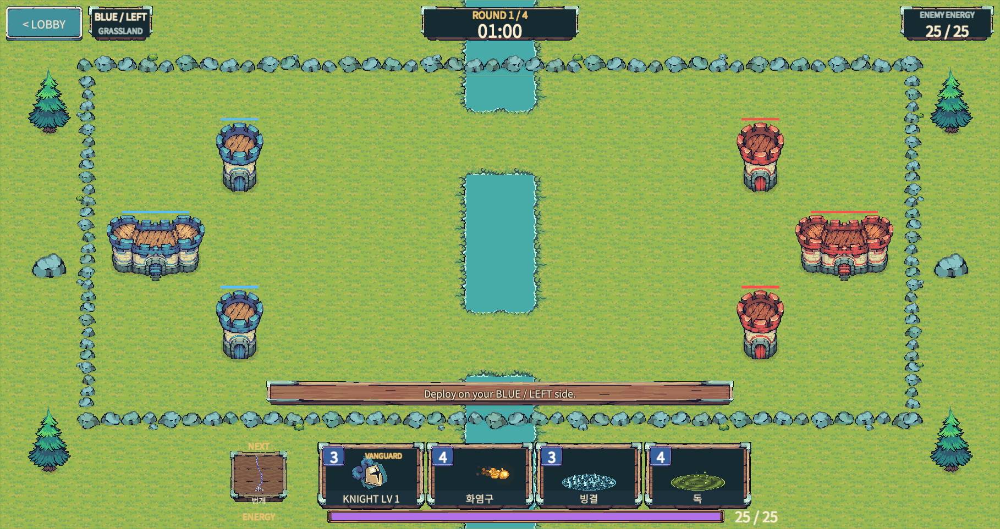

# 박금혁 | 게임 기획·개발 포트폴리오

Unity 전략 대전 게임 **니성내성**을 기획하고 개발하는 박금혁입니다. 직접 플레이하며 바꿀 점을 찾고, AI 개발 도구를 활용해 규칙과 화면으로 구현하고 있습니다. EGO SYSTEM에서는 게임 기획과 UI 전반을, 기업 연계 캡스톤에서는 웹 프론트엔드를 담당했습니다.

[노션 포트폴리오 보기](https://sedate-lemonade-73b.notion.site/41de2140367a812bb2dbe3c74dc3e58e)

## 대표 프로젝트 · 니성내성

**유닛 배치 → 전투 → 증강 선택 → 다음 라운드.** 매 판 비슷하던 전개에 변화를 주려고 증강을 추가했습니다. 아래에서 선택 규칙과 이동 오류 수정 전후, 관련 코드를 확인할 수 있습니다.

[대표작과 작업 사례 보기 →](projects/teamfight/README.md)

## 프로젝트

| 프로젝트 | 담당 역할 | 먼저 볼 내용 |
| --- | --- | --- |
| [니성내성](projects/teamfight/README.md) | 게임 기획·개발, AI 개발 도구 활용 | 증강 선택·주문 카드·힐러 이동 수정 사례 |
| [EGO SYSTEM](projects/ego-system/README.md) | 게임 기획·게임 전반의 UI 개발 | Unity 화면 연결·정보 표시·선택 UI |
| [Incheon-Air](projects/incheon-air/README.md) | 기획·프론트엔드 전반 | 지도·근거 패널·모바일 화면과 실제 변경 이력 |
| [AI 매쓰플래너](projects/mathplanner/README.md) | 서비스 기획·기능 구성·발표·마케팅 방향 | 학습 흐름과 무료 기능 확장 기획, 서비스 소개 영상 |

## 자료 읽는 방법

각 README에서 역할과 결과물을 설명하고 관련 코드로 연결합니다. `source/`는 원본에서 선별한 코드 사본으로, 전체 실행 프로젝트가 아닙니다. 니성내성은 2026년 11월 24일 소스로 갱신했으며, 파일별 수집일과 원본 경로·SHA-256은 [파일 목록](projects/source-manifest.json)에 기록했습니다.

이 저장소의 커밋은 포트폴리오를 정리한 이력입니다. 프로젝트의 과거 개발 이력과는 구분합니다. [개발 기록 안내](DEVELOPMENT_HISTORY.md)에서 확인할 수 있는 실제 이력과 소스의 범위를 설명합니다.

## 담당 범위와 개발 상태

- 니성내성은 무료 출시를 목표로 개발 중입니다. 기획 판단과 플레이 확인을 맡고 코드 구현·원인 분석에는 AI 개발 도구를 활용했습니다. 그래픽에는 Tiny Swords 등 외부 에셋을 사용합니다. 기존 작업명은 팀파이트이며 링크 유지를 위해 폴더명은 `teamfight`로 두었습니다.
- EGO SYSTEM은 2인 팀 프로젝트로, 게임 기획과 UI 전반을 담당했습니다.
- Incheon-Air에서는 기획과 프론트엔드를 맡았습니다. 모델 평가 결과는 팀 성과입니다.
- AI 매쓰플래너는 서비스·마케팅 기획안입니다. 출시 후 이용자 수나 매출은 측정하지 않았습니다.

외부 에셋 원본, 계정 설정, 지원서 초안은 이 포트폴리오 자료 묶음에 포함하지 않습니다. 코드·발표 자료의 공개 라이선스는 부여하지 않았습니다.
