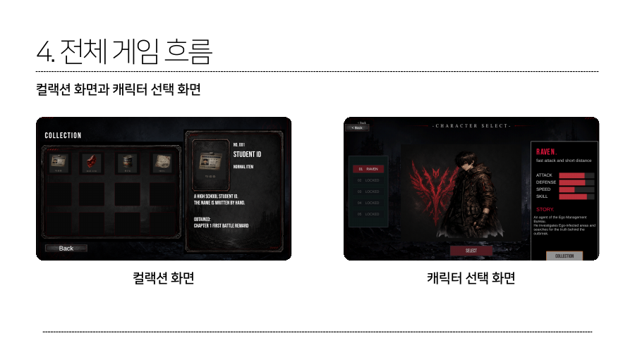

# EGO SYSTEM — 게임 기획과 Unity UI 개발

맵에서 경로를 선택하고 슬롯으로 전투 행동을 결정하는 2D 턴제 RPG입니다.

| 항목 | 내용 |
| --- | --- |
| 팀 | 2인 프로젝트 |
| 담당 | 게임 기획, 게임 전반의 UI 개발 |
| 환경 | Unity 6000.3.11f1, C# |
| 결과물 | 게임 기획 및 화면 기능·정보 표시·화면 간 연결 |

## 담당 범위

게임 기획과 전반적인 UI를 담당했습니다. 아래 코드에는 화면 이동, 도감, 저장 슬롯 선택 기능을 담았습니다.

| 대표 작업 | 구현 내용 | 코드 |
| --- | --- | --- |
| 화면 이동 | 시작·저장 선택·캐릭터 선택·도감·맵 씬 연결 | [SceneLoader.cs](source/SceneLoader.cs) |
| 도감 | 선택한 아이템의 이름·분류·설명·획득 정보·이미지 표시 | [CollectionManager.cs](source/CollectionManager.cs) |
| 저장 슬롯 UI | 슬롯을 선택하면 기존 강조를 해제하고 선택 슬롯 강조 | [SaveSlotManager.cs](source/SaveSlotManager.cs) |

캐릭터 선택 화면에서는 정보·스탯·잠금 상태를 표시했습니다. 항목을 선택하면 해당 정보를 보여주고, 버튼으로 다음 화면에 이동하도록 연결했습니다.

## 구현 범위

첨부한 SaveSlotManager는 선택한 슬롯의 색상을 바꾸는 코드입니다. 파일 저장·불러오기는 향후 개선 항목으로 남았습니다.

## 실행 안내

이 폴더에는 코드 발췌본만 포함되어 있습니다. 전체 원본을 실행하려면 Unity 6000.3.11f1에서 원본 프로젝트를 열어 `Assets/Scenes/StartScene.unity`를 실행합니다. SceneLoader가 사용하는 씬 이름과 프로젝트의 씬 설정이 일치해야 합니다. 이번 자료 정리에서는 전체 게임을 재실행하지 않았습니다.

## 자료 범위

코드는 2026년 11월 19일 로컬 원본에서 가져왔으며, 화면은 팀 최종 발표 자료에서 선정했습니다. 기존 Git 이력은 없으며, 이 저장소에는 자료를 정리한 시점부터 기록을 남겼습니다.

[전체 포트폴리오](../../README.md)
