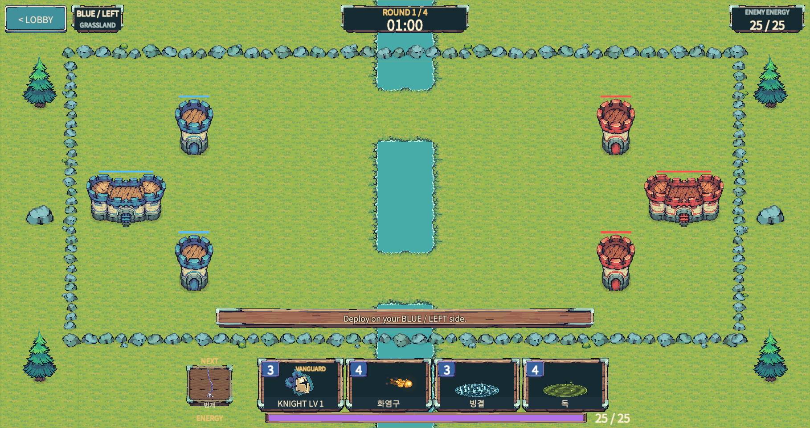
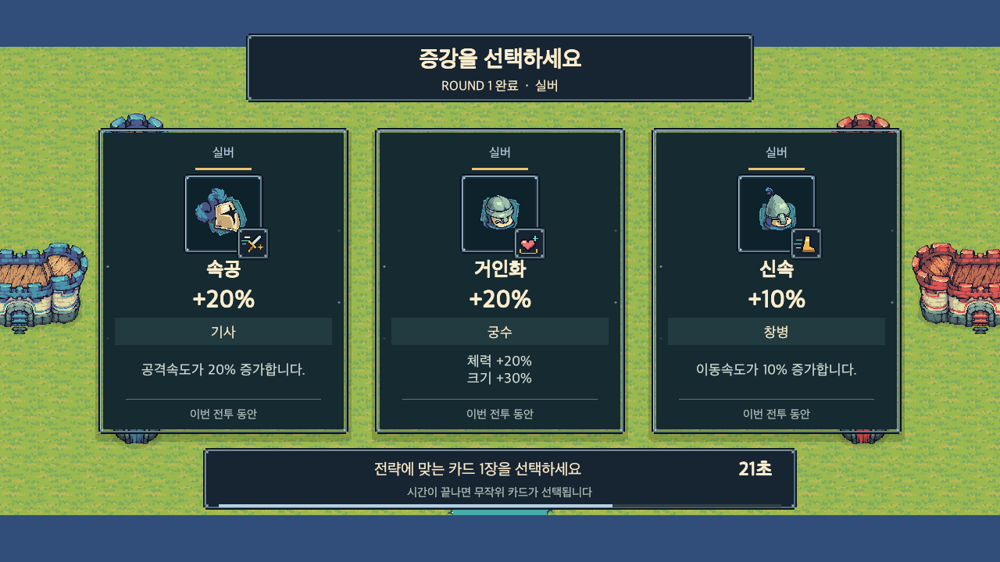

# 니성내성 — 배치와 증강 선택으로 성을 공략하는 전략 대전

유닛 카드를 배치해 상대 성을 공략하는 Unity 게임입니다. 반복되는 전투에 변화를 주려고 증강을 추가했고, 유닛을 보내는 것만으로 부족했던 재미를 보완하려고 주문 카드를 만들었습니다.

| 기간·구성 | 담당 | 환경 | 상태 |
| --- | --- | --- | --- |
| 2026년 7월부터 · 2인 | 게임 기획·개발, 플레이 확인과 수정 | Unity 6 · C# · Codex | 개발 중 · 무료 출시 목표 |

기획 방향과 플레이 결과 판단은 제가 맡고, 코드 구현과 원인 분석에는 AI 개발 도구를 활용했습니다. 팀원과는 매주 회의에서 그 주에 맡을 작업을 정했습니다.

## 플레이 흐름

**카드 선택·배치 → 전투 → 라운드 종료 → 증강 선택 → 다음 라운드.** 유닛과 주문은 7장 덱에 함께 넣으며, 같은 손패와 에너지를 사용합니다. 첫 슬롯은 유닛 선봉으로 고정하고 나머지 슬롯에 유닛이나 주문을 배치합니다.

## 1. 매 판 비슷한 전개에 증강 선택을 추가했습니다

직접 플레이하면서 매 판 비슷한 흐름이 반복된다고 느꼈습니다. 증강 추가 전 버전을 플레이한 친구에게서도 “루즈하다”는 의견을 들었습니다. 다음 전투의 조건을 바꿀 수 있도록 라운드 사이 세 가지 증강 중 하나를 고르는 시스템을 추가했습니다.

선택지는 자신의 덱을 바탕으로 생성하고 동일한 효과·대상 조합은 한 화면에 중복되지 않습니다. 양쪽에 같은 등급을 제공하지만 카드 내용까지 동일하지는 않습니다.

| 골드 등급의 규칙 예시 | 적용 기간 | 달라지는 선택 |
| --- | --- | --- |
| 에너지 +10 | 다음 라운드만 | 다음 라운드의 배치·주문 자원을 늘림 |
| 특정 유닛 총 공격속도 ×1.5 | 남은 전투 | 해당 유닛의 공격 빈도를 높임 |
| 특정 유닛 사거리 ×1.2 | 남은 전투 | 해당 유닛이 공격 가능한 거리를 늘림 |

다음 라운드 자원을 확보할지, 계속 활용할 유닛을 강화할지 고민할 수 있는 구조입니다. 위 조합은 규칙을 설명하기 위한 예시이며 실제 선택률을 측정한 결과는 아닙니다. 추가 전후를 직접 플레이했을 때는 이전보다 선택의 변화가 생겼다고 느꼈습니다. 추가 후 외부 플레이어 평가는 아직 확보하지 않았습니다.

선택 뒤의 흐름도 연결했습니다. 한 명만 고르면 상대 선택 대기를 표시하고, 30초가 지나면 미선택자만 자동 선택합니다. 양쪽 선택이 끝나면 추가 5초 대기 없이 다음 라운드를 시작합니다. 새 경기에서는 이전 증강·유닛·성 체력·에너지·손패를 초기화합니다.

## 2. 주문마다 역할을 나누고, AI가 다르게 이해한 부분을 바로잡았습니다

유닛을 배치해서 보내는 것만으로는 재미가 부족하다고 느껴 주문을 추가했습니다. 제가 정한 역할은 화염구의 물량 정리, 번개의 저비용 둔화, 빙결의 행동 정지, 독의 지속 피해와 회복 차단입니다.

| 주문 | 제가 정한 역할 | 현재 구현된 기본 수치 |
| --- | --- | --- |
| 화염구 | 낮은 코스트의 물량 유닛 정리 | 에너지 4 · 지연 후 범위 피해 160 |
| 번개 | 적은 비용으로 적의 이동·공격을 늦춤 | 에너지 2 · 피해 15 · 3초간 이동·공격 속도 50% 감소 |
| 빙결 | 이동과 공격을 멈춤 | 에너지 3 · 2초 정지 |
| 독 | 지속 피해를 주며 회복 차단 | 에너지 4 · 5초간 초당 피해 18 · 영역 내 회복 불가 |

AI가 독의 효과를 ‘회복량 감소’로 정리했을 때, 제가 원한 것은 회복을 아예 막는 효과라고 다시 설명했습니다. 현재 코드는 독 영역 안에서 회복을 차단하고, 영역이나 지속시간 조건을 벗어나면 회복이 가능하도록 처리합니다. 역할은 제가 정했고, 구체적인 구현과 수치 적용에는 AI의 도움을 받았습니다.

마법 카드를 캐릭터 카드처럼 만들어 달라고 요청했을 때도 처음에는 외형만 바뀌고 별도 버튼으로 남았습니다. 저는 마법도 덱에 넣는 방식이라고 다시 설명했습니다. 이후 유닛과 주문이 같은 손패에서 나오고, 사용하면 에너지를 소모한 뒤 다음 카드로 순환하도록 수정했습니다. 따라서 주문을 쓰는 선택은 유닛 배치에 사용할 자원과 덱 슬롯에도 영향을 줍니다.

## 3. 실제로 보이는 화면과 규칙이 맞는지 확인했습니다

| 제가 발견한 문제 | 수정 방향 | 확인한 구현 |
| --- | --- | --- |
| 예고 범위와 실제 타격 범위가 달라 혼란스러움 | 미리 보는 영역과 실제 적용 영역을 일치시킴 | 미리보기·바닥 효과·타격 판정이 같은 타원형 범위 사용 |
| 독 효과가 유닛을 가림 | 효과가 있어도 전투 상황을 볼 수 있도록 조정 | 독 영역을 유닛 아래에 렌더링 |
| 시작 전 덱에 마법 그림이 빠짐 | 전투 전에 선택한 카드를 확인할 수 있도록 수정 | 주문 그림·이름·비용 표시 |
| 성 게이지가 공격에 비해 이상하게 보임 | 실제 체력과 화면 비율을 대조하도록 요청 | 계산은 정상이었고 가독성 보완: 두께·테두리·피해 잔상 적용 |

화염구 연출은 포물선과 하늘에서 떨어지는 안을 나란히 비교한 뒤 사선 낙하를 선택했습니다. 낙하 가속은 유지하되 전체 속도를 조금 늦추도록 다시 요청했고, 낙하 시간은 1.35초에서 1.65초로 조정됐습니다. AI의 첫 결과를 그대로 쓰기보다 직접 보고 원하는 동작과 어긋나는 부분을 좁혀 수정했습니다.

## 4. 이동 오류와 협업

유닛이 다리에 걸리거나 빙빙 돌고 의도와 다른 방향으로 이동하는 현상을 확인해 수정을 요청했습니다. 관련 힐러 수정에서는 사거리를 잠시 벗어난 아군을 계속 추적하고 회복 준비 시간을 보존하도록 바뀌었습니다. 건강한 힐러끼리 서로 따라가는 동작도 막았습니다. 원인 분석과 코드 수정은 AI의 도움을 받았으며, 당시 격리 검사 13건 통과 기록이 있습니다.

팀원과 매주 회의에서 작업을 나누고, 개발 중 어려운 부분은 게임 업계 경험이 있는 교수님께 상담을 신청해 도움을 구했습니다.

## 코드와 검증 기록

| 자료 | 확인할 내용 |
| --- | --- |
| [BattleAugmentRules.cs](source/BattleAugmentRules.cs) | 등급·효과·덱에 따른 선택지 생성, 중복 방지 |
| [DuelSimulation.Augments.cs](source/DuelSimulation.Augments.cs) | 선택 확정·타임아웃·효과 적용·라운드 전환 |
| [BattleSpellRules.cs](source/BattleSpellRules.cs) | 주문 비용·범위·지연·지속시간·회복 차단 |
| [AugmentBattleChecks.cs](source/AugmentBattleChecks.cs) | 증강 선택과 전환 규칙 검사 |
| [검증 기록과 출처](EVIDENCE.md) | 날짜별 기록과 남은 검증 범위 |

코드는 2026년 11월 24일 원본에서 가져온 발췌본이며 단독 실행되지 않습니다. 최신 주문·증강 변경의 실제 두 기기 온라인 대전과 실기기 터치는 추가 검증이 필요합니다. 이번 자료 보완에서는 게임 테스트를 다시 실행하지 않았습니다. 주문 추가 후 재미 개선을 측정한 결과도 아직 제시하지 않았습니다.

원본 프로젝트는 Unity Version Control로 관리합니다. 이 GitHub의 커밋은 포트폴리오 정리 이력입니다. 그래픽에는 Tiny Swords 등 외부 에셋을 사용하며 무료 출시는 목표입니다. 기존 작업명은 팀파이트이고 폴더명은 링크 유지를 위해 그대로 두었습니다.

[노션 상세 페이지](https://sedate-lemonade-73b.notion.site/41de2140367a81179661fdab4eaf75e8) · [전체 포트폴리오](../../README.md)
